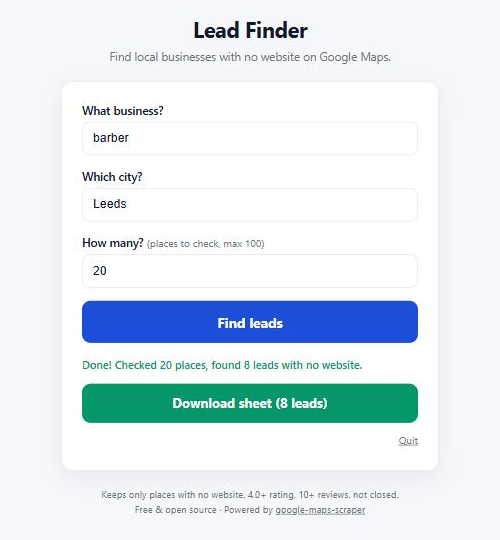

<p align="center">
  
</p>

<h1 align="center">Lead Finder: find local businesses with no website</h1>

<p align="center">
  <b>Free desktop app that finds local businesses with no website on Google Maps and exports them to a spreadsheet.</b><br>
  Windows, Mac and Linux. No account, no API key, no coding.
</p>

<p align="center">
  <a href="https://github.com/justlinuxnoob/local-business-lead-finder/releases/latest"><b>⬇ Download the latest version</b></a>
</p>



Type a kind of business (for example **barber**) and a city (for example **Leeds**). Lead Finder searches Google Maps, keeps only the good prospects, and gives you a spreadsheet you can open in **Google Sheets** or **Excel**. It is made for freelancers and small web design agencies who sell websites to local businesses.

## What you get

A CSV sheet with these columns:

| Name | Category | Town | Phone | Rating | Reviews | Google Maps link | Status |
|---|---|---|---|---|---|---|---|
| Example Barbers | Barber shop | Leeds | 0113 496 0000 | 4.8 | 57 | https://www.google.com/maps/… | *(empty, for your notes)* |

Only places that are worth calling are kept:

- **No website** listed on Google Maps
- Rating **4.0 or higher**
- **10 or more** reviews
- **Not permanently closed**
- **No duplicates**

The empty **Status** column is for you: write "called", "interested", "sold"… as you work through the list.

## Download

Go to the **[latest release](https://github.com/justlinuxnoob/local-business-lead-finder/releases/latest)** and download the one file for your computer:

| Your computer | Download |
|---|---|
| Windows 10 / 11 | `LeadFinder-windows-x64.exe` |
| Mac with Apple Silicon (M1, M2, M3, M4…) | `LeadFinder-mac-apple-silicon.zip` |
| Mac with Intel chip | `LeadFinder-mac-intel.zip` |
| Linux | `LeadFinder-linux-x64.tar.gz` |

Not sure which Mac you have? Click the Apple menu → **About This Mac**. If it says "Chip: Apple M…", pick Apple Silicon. If it says "Processor: Intel", pick Intel.

## How to use it (3 steps)

1. **Open the app.** Double-click the file you downloaded. A small window opens (keep it open) and your browser shows the Lead Finder page.
2. **Search.** Type what business (e.g. `barber`), which city (e.g. `Leeds`) and how many places to check (up to 100). Click **Find leads**.
3. **Download.** When it says *Done*, click **Download sheet**. Open it in Google Sheets (File → Import) or Excel.

The very first time, you will see *"First time setup: downloading (about 150 MB), only once."* Lead Finder is downloading the browser it uses to read Google Maps. This happens only once.

When you are finished, click **Quit** on the page or close the small window.

## Opening it the first time

The app is free and not signed with a paid Apple or Microsoft certificate, so your computer will ask you to confirm the first time. This is normal for free, open-source apps.

### Windows: "Windows protected your PC"

1. Double-click `LeadFinder-windows-x64.exe`.
2. If a blue box says **"Windows protected your PC"**, click **More info**.
3. Click **Run anyway**.

You only need to do this once.

### Mac: "cannot be opened because the developer cannot be verified"

1. Double-click the `.zip` file to unzip it. You get a file called `LeadFinder`.
2. **Right-click** (or Control-click) `LeadFinder` → **Open** → **Open**.

If you don't see an **Open** button:

1. Try to open the app once, then click **Done**.
2. Open **System Settings** → **Privacy & Security**.
3. Scroll down. Next to *"LeadFinder" was blocked*, click **Open Anyway**, then enter your Mac password.

A Terminal window opens: that is the app running. Keep it open while you use Lead Finder.

### Linux

```bash
tar -xzf LeadFinder-linux-x64.tar.gz
./LeadFinder
```

If the browser fails to start, install Chromium's system libraries once with `npx playwright install-deps chromium`.

## FAQ

**Is it free?**
Yes. Lead Finder is free and open source (MIT license). No account, no subscription, no API key. Google Maps data is read the same way you would read it in your browser.

**Does it work on Mac?**
Yes, on both Apple Silicon (M1/M2/M3/M4) and Intel Macs. See [Opening it the first time](#mac-cannot-be-opened-because-the-developer-cannot-be-verified).

**Why does Windows warn me?**
Windows SmartScreen warns about any new app that isn't signed with a paid certificate and hasn't been downloaded by many people yet. Lead Finder is built automatically by GitHub from the public source code in this repository, and every release lists SHA256 checksums so you can check the file is exactly what GitHub built. Click **More info → Run anyway**.

**Why do some searches find few leads?**
Most busy businesses already have a website. Try other trades (cleaners, mechanics, nail salons, takeaways, plumbers) or smaller towns. You can also check more places (up to 100).

**Where is my data stored?**
Nowhere except your own computer. The app runs only on your machine, at a local address (`http://127.0.0.1:8765`). Nothing is sent to us.

**How do I check a download is genuine?** *(optional)*
Each release includes `SHA256SUMS.txt`. On Windows: `certutil -hashfile LeadFinder-windows-x64.exe SHA256`. On Mac/Linux: `shasum -a 256 <file>`. The result should match the line in `SHA256SUMS.txt`.

## Responsible use

- Keep searches **small**. Lead Finder checks at most 100 places per search, one at a time, with short pauses, on purpose.
- Respect **Google's Terms of Service** and the laws where you live and work (for example GDPR and rules on cold calling and marketing).
- Use the list to offer something genuinely useful, and don't contact people who ask you not to.
- Don't resell or publish the data.

You are responsible for how you use this tool.

## Credits

Lead Finder is built on **[google-maps-scraper](https://github.com/gosom/google-maps-scraper)** by **[Georgios Komninos (gosom)](https://github.com/gosom)**, MIT licensed. All the Google Maps reading comes from that project (and gosom's [scrapemate](https://github.com/gosom/scrapemate)); Lead Finder adds the simple app, the "no website" filter and the spreadsheet. If you find it useful, please go and star gosom's project. 🙏

It also uses [playwright-go](https://github.com/playwright-community/playwright-go) (MIT). Their license texts are in [`third_party/`](third_party/).

## For developers

```bash
go test ./...
go run .            # opens http://127.0.0.1:8765
```

Releases are built by [GitHub Actions](.github/workflows/release.yml) on native Windows, macOS and Linux runners when a `v*` tag is pushed. Binaries are not packed or obfuscated (no UPX), and each release includes SHA256 checksums.

## License

[MIT](LICENSE)

---

### Built for Web Empire

Learn how to build and sell websites to these businesses for free: https://www.skool.com/web-empire-7146

Build the websites with AI: https://ginta.app
